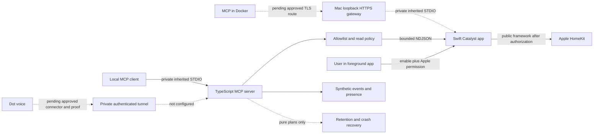

# Architecture and implementation boundaries

The product goal is voice-assisted home interaction, camera-event search and room-presence queries through an approved dot connection. The executable stage is read-only; all real permissions, physical actions, cameras and household-data transfer remain gated. The complete product goal is not represented as working by this prototype.

## Executable local boundary

The MCP process uses the official TypeScript SDK v2, pinned to 2.3.1. It exposes six tools, each with strict schemas and read-only annotations. There is no generic execute/write/scene/automation API, dynamic shell argument, camera download function, or network listener. SDK STDIO buffering is capped at 1 MiB; configuration reads allocate at most 65,537 bytes. The config rejects unknown fields, wildcard/duplicate IDs and write mode. HomeKit UUID casing is normalized.

Mock mode is the default. Real mode requires an explicit native launch flag plus absolute resolved config and executable paths. The helper receives only its fixed `--stdio --config PATH` arguments and a small environment allowlist, never the full client's token environment. Responses are correlated by random request IDs, limited to 1 MiB, schema checked, filtered and redacted again. Only one native request is in flight; parallel calls fail with `BRIDGE_BUSY`. Individual reads time out at ten seconds, and an unresponsive helper is terminated with a bounded TERM/KILL sequence. The helper's stderr is never forwarded into model-visible output.

Swift uses a public Mac Catalyst app identity. `HMHomeManager` construction exists in exactly one user-button path. STDIO has no enable/authorize command. Session enablement is not persisted; Apple's own privacy choice is persistent and is controlled by the user in system settings. The app's file picker grants configuration-file access for that process without storing a bookmark. The initial policy is deny-all. Native policy checks precede reads, and generation/manager/allowlist checks repeat after asynchronous callbacks to handle revocation and reloads safely.

Read values are safe Boolean/numeric HAP sensor/state characteristics only. Native list uses prior successful observation times; individual read clears old values before refreshing and omits failed/timed-out values. Accessory-level time is a topology observation, not proof that every characteristic is current. The occupancy adapter reads up to eight matching allowlisted sensors sequentially, ignores missing/unreachable readings, and preserves supporting observation time. It never treats lack of motion as proof of emptiness.

No identifying household content is used in tests. Local fixture assets are opaque metadata references, not media URLs. Named-person location has no configured signals or consents. Its domain model permits only explicit, unexpired, signal-specific consent for noncamera device/presence indications and refuses appearance identity. Camera authorization is not consent to locate people.

## Requested Docker split

The delivered Dockerfile builds the TypeScript server, tests synthetic behavior and copies production dependencies into a non-root runtime. Mock Compose has no network. Host Compose is an opt-in profile; it can call only an explicitly configured HTTPS `host.docker.internal` endpoint, validates a supplied private CA and uses an owner-only token. It cannot execute the native app. The macOS gateway retains the Swift child and the same local allowlist policy. Its source binds loopback only, requires explicit launch approvals and supplied TLS/token files, rejects browser origins and unsupported commands, and bounds messages/connections/timeouts. It has never been started in this task. [Host gateway](host-gateway.md), [Docker setup](docker.md)

This local shared-token channel is distinct from cloud OAuth. It supplies no permission to share household state with dot. Docker engine is unavailable, so image execution and the Docker Desktop route to loopback are pending proof. Do not broaden the gateway to LAN or disable certificate checks to work around routing. No actual storage/index worker or media volume is active; Docker holds only MCP and pure planner code in the delivered stage.

## Intended dot connection, pending setup

Local client configuration is not a cloud connection. The candidate private route is OpenAI's documented [Secure MCP Tunnel](https://developers.openai.com/api/docs/guides/secure-mcp-tunnels), using outbound HTTPS from the local host. No tunnel software, API key, workspace association, account capability, connector or ongoing process has been configured. This route must first be available to the deploying account and approved for the exact dot/workspace. A synthetic read-only call observed from the actual voice surface is the acceptance test; a local smoke test cannot substitute for it.

The future connector boundary should use an established OAuth authorization server, token verification and revocation, subject/tool/data-class/accessory scopes, rate limits, and explicit sharing approval. `connector-policy.ts` is a pure authorization decision module with a default-deny verifier; **it is not an implemented OAuth server or HTTP endpoint**. Production transport must obtain cryptographically verified claims via a trusted verifier, validate issuer/audience/expiry, enforce narrow policy before calling the same read tools, and intersect caller accessory grants with the native/TypeScript allowlists. No decoded unverified JWT or body-supplied subject is trusted. No credentials are created in this project.

Initial remote access, if later approved, must begin with synthetic status only. Household state must remain unavailable until a separate approved data-class scope. Media requires another explicit grant and a verified implementation. Persistent access must be revocable locally and in the connector. Bound audit records without raw names, images, tokens or recording contents; logs count toward the cache budget.

Future physical actions need their own narrow tool and device scope, an explicit authorization policy, replay/expiry protection and confirmation behavior verified in the actual voice client. No action executor is in this code. Lock/garage commands are outside this implementation. Do not infer permission to actuate from read permission or from a conversational model's confidence.

## HomeKit-only camera history and cache

`HomeKitSecureVideoHistoryProvider` returns `status: unavailable` with `public_history_api_unavailable`; it never returns an empty event list suggesting no events. Public Apple camera headers and docs expose snapshots and streams, not an HSV/iCloud historical recording catalogue. This is an API feasibility blocker independent of signing and user permission. Consumer Home app history does not establish a third-party export API.

No raw snapshot/video exporter is implemented. Before a prospective cache can be enabled, prove a supported public pixel/export path, per-camera allowlist, explicit capture authorization and acceptable Mac resource usage. No private API, iCloud-key extraction, Home-app scraping, vendor-specific camera backend or server-side HomeKit replacement is introduced. A NAS or Google Drive destination stores future app-owned objects only; it cannot run the Catalyst HomeKit framework or recover inaccessible iCloud history by itself.

The pure retention/recovery planners define independently bounded age/bytes, temporary/log/sidecar accounting, free-space reserve, strict owned namespaces, whole-bundle cleanup, short-segment finalization, transactional index recovery, capped local spool and visible gaps. They do not encrypt, record, transfer, allocate or delete any file. Exact policy and a filesystem executor require later review. At local cap or low disk, the default future behavior is stop, with no automatic growth, unlimited fallback or silent eviction of unarchived data. See [retention design](retention.md).

## Approval and proof gates

| Gate | Exact pending action | Why it cannot be completed automatically now |
| --- | --- | --- |
| Apple identity | User selects authorized Team/App ID and HomeKit provisioning in Xcode | Zero valid signing identities; no account/credential changes authorized |
| HomeKit data | User enables session and handles Apple's privacy prompt | Access is persistent at OS level and needs user's explicit action |
| Real read | User selects accessory UUIDs and approves narrow read test | No real discovery or home topology access performed |
| Docker runtime | User starts their configured engine, then runs bounded mock image build/smoke | No engine socket; actual image/runtime and loopback TLS tests unavailable |
| Camera capture | Approve one camera/API export feasibility test | No live camera permission; history API and raw export are distinct |
| Retention/storage | Select exact age, reserve, NAS/cloud quota and eviction policy | Range/draft cap only; no actual cache executor approved |
| Remote/voice | Approve private connector/auth, then observe synthetic voice tool call | Account availability and intended voice surface unverified |
| Real actuation | Define and approve device/action policy | No action executor or physical control authorized |

No gate was denied by automatic approval review. The public npm dependency downloads were approved. The remaining real-access operations were deliberately not attempted and are **pending user action**, with HSV history also blocked by public-API feasibility.
